<!--
File: README.md
Description: Public GitHub organization profile for CyperZaX (rendered at github.com/CyperZaX from the .github repo's profile/ folder). Logo: idle variant of the animated_logos/cyperzax package v1.0.0.
Author: Jose-Jorge HERNANDEZ
Company: CyperZaX
Date: 2026-11-19
Last edit date: 2026-11-19
Version: 1.1.0
-->

<picture>
  <source media="(prefers-color-scheme: dark)" srcset="../assets/logos/animated/cyperzax_logo_idle_dark.svg">
  
</picture>

# CyperZaX

### Securing Every Space, Digital and Physical.

Enterprise cybersecurity where digital and physical defense converge.

---

## What we do

CyperZaX protects organizations end to end: the networks, servers and data they
run on, and the buildings and sites they work in. One team covers both, so
nothing falls into the gap between them.

| | Pillar | What it covers |
|:-:|---|---|
| 🛡️ | **Security Operations** | Cyber security, risk assessment, network security, server monitoring, email protection, backup & recovery |
| 🔐 | **Digital Assets Shield** | Cloud storage security, data protection, hacking shield, website analysis, proactive threat intelligence |
| ☁️ | **On Demand Protection** | Secure private cloud, online backup, secure websites, enterprise networks, secure collaboration |
| 📡 | **CyberSecurity Basics** | Surveillance & physical security, managed digital security, Smart-Place IoT, drone services |

## How we work

- **Converged defense.** Digital and physical security planned together, not as two separate contracts.
- **Proactive, not reactive.** Monitoring and threat intelligence that spot problems before they become incidents.
- **Built to your size.** From a single office to a multi-site enterprise network.

## Reporting a security issue

Found a vulnerability in something we build or operate? Please report it privately to
**[secure@cyperzax.com](mailto:secure@cyperzax.com)** instead of opening a public issue.
We acknowledge every report and keep you informed while we fix it.

---

CyperZaX · a Parlee Conseiller company

